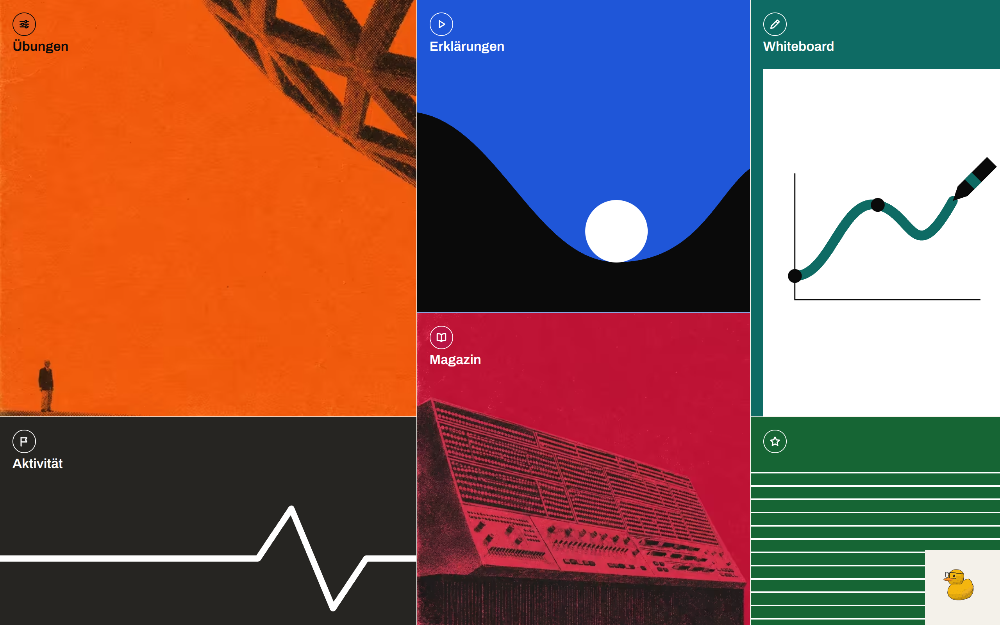
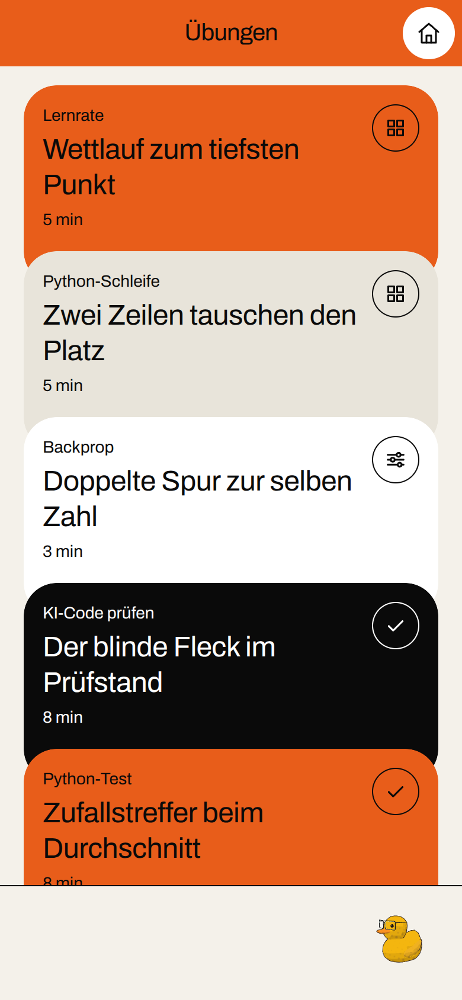
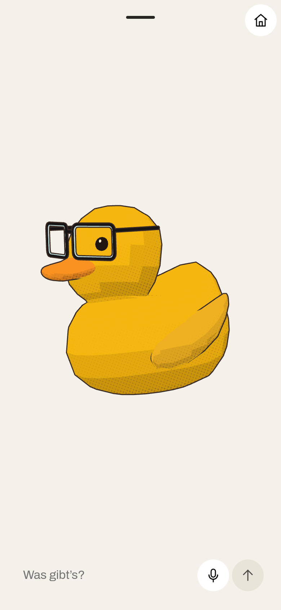

# AI Tutor App

UI v4 is a German-language learning interface for the demo course _KI selbst bauen_. It combines interactive explanations, short exercises and a Socratic tutor. The built-in mock tutor runs locally without an API key.

## Run locally

Use Node.js `^20.19.0 || ^22.12.0 || >=24.0.0` and npm.

```sh
npm ci
npm run dev -- --host 127.0.0.1 --port 5173
```

Open `http://127.0.0.1:5173`. The app starts in demo mode by default. The top-edge drawer opens settings for the tutor connection, speech and local learning memory. A live backend can be configured with `PUBLIC_TUTOR_API_URL` or a deployed `tutor-config.json`. The [architecture guide](docs/ARCHITECTURE.md) documents the mock and HTTP clients.

## UI v4 gallery

Screenshots at 2× pixel density from desktop (1280×800) and mobile (390×844).

| Home · desktop                                                       | Exercises · mobile                                              | Tutor · mobile                                                      |
| -------------------------------------------------------------------- | --------------------------------------------------------------- | ------------------------------------------------------------------- |
|  |  |  |

| Screen                    | Desktop                                                   | Mobile                                                  |
| ------------------------- | --------------------------------------------------------- | ------------------------------------------------------- |
| Home                      | [Desktop](docs/screenshots/home-desktop.png)              | [Mobile](docs/screenshots/home-mobile.png)              |
| Learning queue on home    | [Desktop](docs/screenshots/home-queue-desktop.png)        | [Mobile](docs/screenshots/home-queue-mobile.png)        |
| Attention lab             | [Desktop](docs/screenshots/attention-desktop.png)         | [Mobile](docs/screenshots/attention-mobile.png)         |
| Attention bubbles         | [Desktop](docs/screenshots/attention-bubbles-desktop.png) | [Mobile](docs/screenshots/attention-bubbles-mobile.png) |
| Backpropagation lab       | [Desktop](docs/screenshots/backpropagation-desktop.png)   | [Mobile](docs/screenshots/backpropagation-mobile.png)   |
| Exercise list             | [Desktop](docs/screenshots/exercises-desktop.png)         | [Mobile](docs/screenshots/exercises-mobile.png)         |
| Exercise with slider      | [Desktop](docs/screenshots/exercise-slider-desktop.png)   | [Mobile](docs/screenshots/exercise-slider-mobile.png)   |
| Exercise with keypad      | [Desktop](docs/screenshots/exercise-keypad-desktop.png)   | [Mobile](docs/screenshots/exercise-keypad-mobile.png)   |
| Code exercise             | [Desktop](docs/screenshots/exercise-code-desktop.png)     | [Mobile](docs/screenshots/exercise-code-mobile.png)     |
| Sketch exercise           | [Desktop](docs/screenshots/exercise-sketch-desktop.png)   | [Mobile](docs/screenshots/exercise-sketch-mobile.png)   |
| Tutor                     | [Desktop](docs/screenshots/tutor-desktop.png)             | [Mobile](docs/screenshots/tutor-mobile.png)             |
| Tutor wardrobe Easter egg | [Desktop](docs/screenshots/tutor-hipster-desktop.png)     | [Mobile](docs/screenshots/tutor-hipster-mobile.png)     |
| Whiteboard                | [Desktop](docs/screenshots/whiteboard-desktop.png)        | [Mobile](docs/screenshots/whiteboard-mobile.png)        |
| Activity                  | [Desktop](docs/screenshots/activity-desktop.png)          | [Mobile](docs/screenshots/activity-mobile.png)          |
| Magazine                  | [Desktop](docs/screenshots/magazine-desktop.png)          | [Mobile](docs/screenshots/magazine-mobile.png)          |
| Interactive essay         | [Desktop](docs/screenshots/magazine-essay-desktop.png)    | [Mobile](docs/screenshots/magazine-essay-mobile.png)    |

## How the prototype works

- **Practice and transfer.** Exercises ask for a prediction or an answer before feedback. Independent probes run with tutor assistance and hints locked.
- **Interactive explanations.** The Attention and Backpropagation labs pair simulations with predictions and formulas rendered by local KaTeX.
- **Tutor and learning memory.** The fullscreen duck handles dialogue. The corner duck can answer questions about the current screen. Visits and notes are stored in the browser and can be reviewed or cleared in the drawer.
- **Whiteboard, activity and magazine.** Draw and hand off a sketch, review dated evidence of practice, or read an interactive essay. External videos load when played.

The app uses deterministic demo fixtures. It explores how tutoring can support assisted practice and still leave room to test unassisted transfer. The repository records software checks. See the [design contract](DESIGN.md) for interaction rules and [ai-tutor-core](https://github.com/dweigend/ai-tutor-core) and [ai-tutor-bench](https://github.com/dweigend/ai-tutor-bench) for the companion backend and evaluation harness.

## Verify and build

```sh
npm run lint
npm run check
npm run check:glyphs
npm run check:modules
node --experimental-strip-types --test 'src/**/*.test.ts'
npm run build
npm run preview -- --host 127.0.0.1 --port 4173
```

The static build is written to `build/`. The preview opens at `http://127.0.0.1:4173`.

## AI-assisted development

Generative AI coding, drafting, and image/3D assistance tools were used during development under human architectural direction:

- **Areas of AI use:** Svelte 5 / TypeScript implementation, unit test scaffolding, Blender Python rig/mesh generation (`duck_v3.glb`), editorial illustration generation (`scripts/art-masters/`), German instructional draft iteration, and multi-model code/design review against `DESIGN.md`.
- **Human verification & automated gates:** Design rules (`DESIGN.md`), pedagogical boundaries, citation accuracy, YouTube video metadata/embed checks, AST module checks (`check:modules`), font glyph checks (`check:glyphs`), and WCAG 2.2 AA contrast matrices (`tokens-contrast.test.ts`) were specified, audited, and verified deterministically. No private student records or personal learner data were used at any stage.

## Citation

When citing this prototype in academic or technical work, please reference the specific release tag or commit SHA:

```bibtex
@software{weigend2026aitutorapp,
  author  = {Weigend, David},
  title   = {AI Tutor App: German-Language Socratic Learning Interface and Design System},
  year    = {2026},
  url     = {https://github.com/dweigend/ai-tutor-app},
  note    = {Pin concrete release tag or commit SHA for reproducibility}
}
```

## Licenses

- **Application source code (`src/`, `scripts/`, configs):** [MIT License](LICENSE)
- **Bundled _„KI selbst bauen“_ course demo texts (`src/lib/content/`):** [CC BY 4.0](https://creativecommons.org/licenses/by/4.0/) (code snippets inside tasks under MIT)
- **Bundled fonts (`Archivo`, `JetBrains Mono`):** [SIL Open Font License 1.1](static/fonts/README.md)
- **Third-party libraries, GSAP Standard License note, media embeds & visual assets:** See [**`NOTICES.md`**](NOTICES.md) for complete per-component attribution and redistribution boundaries.
