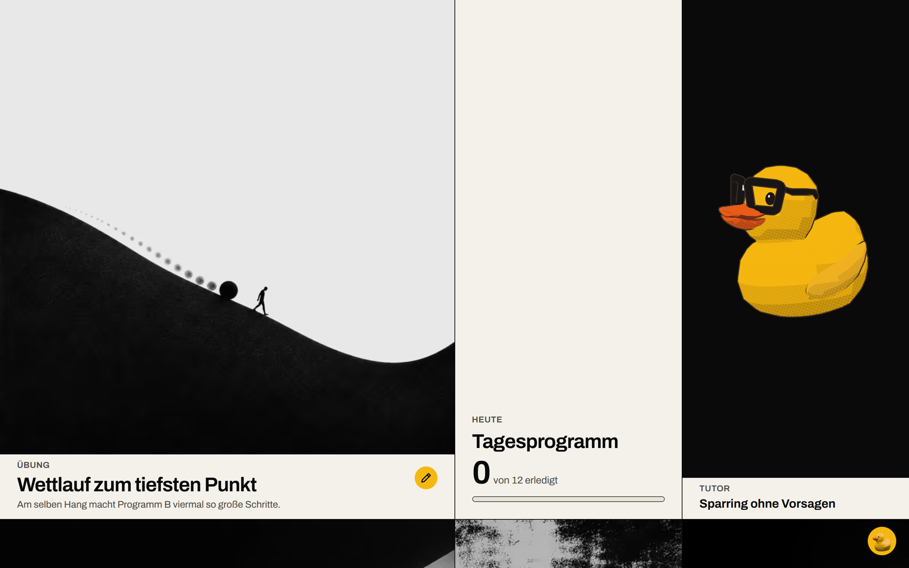
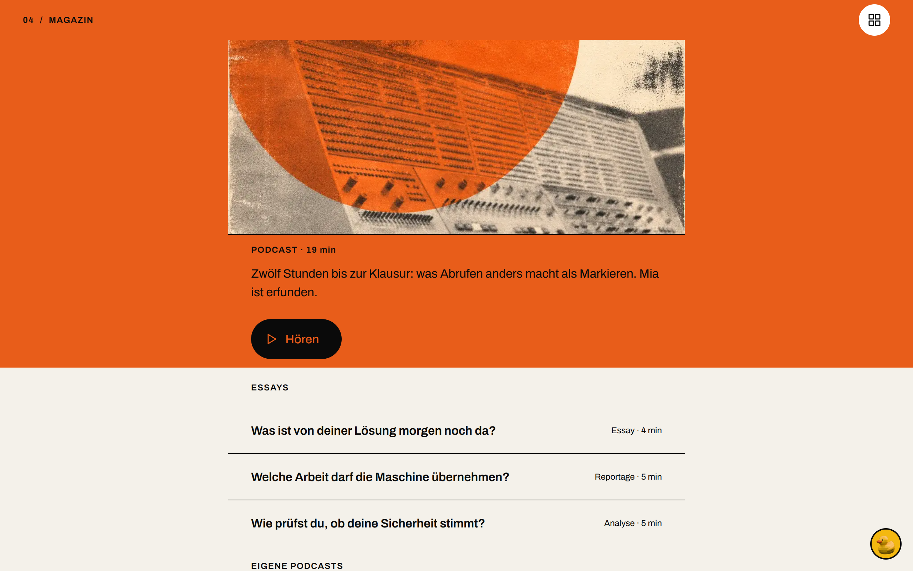
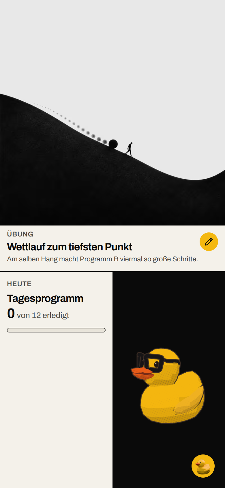
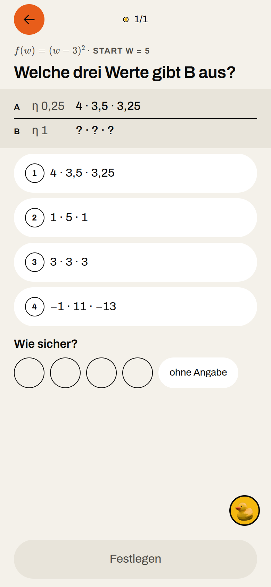
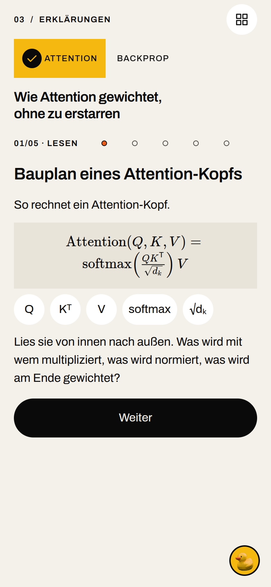
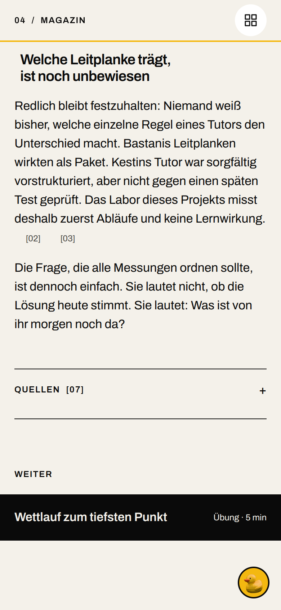
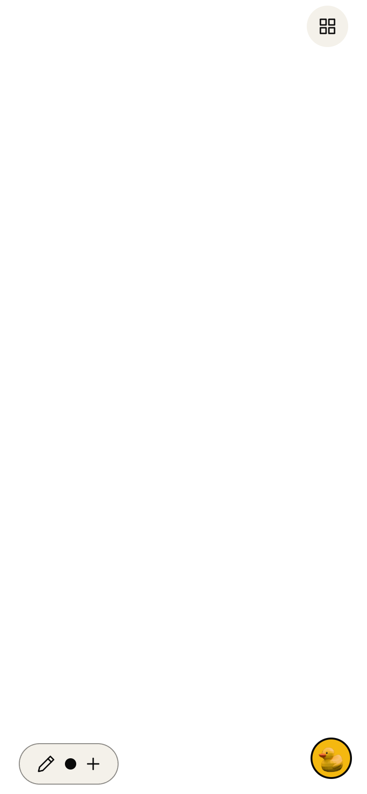
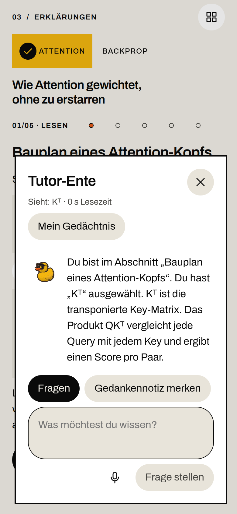

# AI Tutor App

**German-language learning interface · Teaching & Research Prototype (SvelteKit 5)**

`ai-tutor-app` is the learner-facing web frontend of a modular open-source research system investigating Socratic AI tutoring in computer science and machine learning education. It pairs with [`ai-tutor-core`](https://github.com/dweigend/ai-tutor-core) (dialogue state machine, pedagogical guards, and model adapters) and [`ai-tutor-bench`](https://github.com/dweigend/ai-tutor-bench) (offline replay and evaluation harness), and runs standalone offline at `0.00 USD` via a deterministic in-browser mock tutor.

> **Language note:** Repository documentation, source comments, and API schemas are documented in English; the learner-facing user interface and the bundled demonstration course (_„KI selbst bauen“_) are written in German.

---

## 1. Research Question & Pedagogical Principles

**Core question:** _How should an AI-supported learning environment separate guided practice from unassisted transfer, and govern when a tutor intervenes versus withholds assistance?_

Recent empirical work demonstrates that performance _during_ AI-assisted practice is an unreliable proxy for durable human understanding:

- **Assisted practice vs. unassisted transfer (Bastani et al., _PNAS_ 2025, [doi:10.1073/pnas.2422633122](https://doi.org/10.1073/pnas.2422633122)):** In a randomized field experiment in high-school mathematics, access to an unconstrained LLM (`GPT Base`) raised practice scores by **+48%** relative to an unassisted control group, and a prompt-guarded tutor (`GPT Tutor`) raised practice scores by **+127%**. On the subsequent **unassisted exam**, however, `GPT Base` students scored **−17%** below control (cognitive offloading), while `GPT Tutor` showed no statistically significant difference from control (_n. s._).
- **Coursework vs. post-test comprehension (TUM field study, _N_ = 275 evaluated students):** Programming students assisted by the course tutor _Iris_ or _ChatGPT_ achieved higher exercise scores during assisted coursework, whereas an immediate unassisted post-test of conceptual and code comprehension showed no statistically significant gain.
- **Dynamic intervention control (_DICE_ framing):** Rather than treating tutoring as unconstrained text generation, the decision _whether_ and _how strongly_ to intervene—waiting (`warten`), probing (`nachhaken`), demanding a prediction (`vorhersage_verlangen`), offering a graded hint (`gestufter_hinweis`), or showing an analogous example (`beispiel_zeigen`)—is treated as an explicit pedagogical control boundary that trades off premature hints during productive struggle against missed support during impasses.

### Operationalized Interface Guards

1. **Explicit delegation boundary:** Every tutor scenario states which cognitive steps remain strictly with the learner (e.g., selecting a candidate model and computing residuals) and what the tutor is permitted to do (e.g., demonstrating an arithmetic step on an analogous number pair with an enforced return obligation to the learner's own task).
2. **Independent probe mode (`independent-probe`):** Dedicated transfer tasks lock contextual tutor scaffolding (`isProtectedTutorTurn`), suppress graded hints, and suspend memory-visit tracking until the learner submits and reveals the probe—preventing assisted practice from contaminating transfer evidence.
3. **Confidence calibration before feedback:** Exercises pair candidate answers with explicit self-rated confidence (`0–100%`) prior to resolution, surfacing miscalibration on plausible misconceptions rather than encouraging rapid trial-and-error clicking.
4. **Zero streaks, zero dark patterns:** The interface contains no daily streaks, XP counters, leaderboards, toast popups, confetti, or punitive red/green traffic-light grading (`DESIGN.md` §5.8, §15).

---

## 2. Visual Tour

### Desktop (`1280×800`)

|                                 Home Tile Grid (`/`)                                  |                          Fullscreen 3D Tutor (`/tutor`)                           |                             Editorial Magazine (`/magazin`)                             |
| :-----------------------------------------------------------------------------------: | :-------------------------------------------------------------------------------: | :-------------------------------------------------------------------------------------: |
|                           |      |                    |
| Full-bleed physical tile grid with reactive daily dot ring; sole navigation overview. | Chrome-free Socratic dialogue stage with rigged low-poly 3D halftone rubber duck. | Print-inspired editorial overview combining essays, audio chapters, and video lectures. |

### Mobile (`390×844`)

|                           Home (`/`)                            |                              Exercise Stage (`/uebungen`)                               |                         Explanations (`/erklaerungen`)                         |                           Fullscreen Tutor (`/tutor`)                            |
| :-------------------------------------------------------------: | :-------------------------------------------------------------------------------------: | :----------------------------------------------------------------------------: | :------------------------------------------------------------------------------: |
|              |                  |             |       |
| Tactile tile stack with 2 px ink-edge lift and category labels. | Single-task focus stage with prediction, confidence calibration, and 56 px pill action. | Phenomenon-first interactive labs with local KaTeX and tappable formula terms. | Voice- and text-ready Socratic stage with artifact overlay and backend switcher. |

|                       Interactive Essay (`/magazin/[slug]`)                       |                      Whiteboard (`/whiteboard`)                       |                          Global Corner Companion & Memory                           |
| :-------------------------------------------------------------------------------: | :-------------------------------------------------------------------: | :---------------------------------------------------------------------------------: |
|                              |        |                  |
| Interactive data figure with accessible table and paragraph-level read-aloud bar. | Distraction-free 4:3 vector canvas with floating icon-pill tool dock. | Route- and term-aware corner duck companion with transparent local learning memory. |

---

## 3. Feature Highlights

- **Physical Tile Home Screen (`/`):** Full-bleed responsive grid (`Tile`, `TileGrid`) without a top navigation bar, sidebar, or bottom tab bar (`DESIGN.md` §1.6). Every sub-route returns directly to `/` via the 56 px header grid link (`SurfaceShell.Grid`) using hard-edged surface clip transitions. Tiles respond with a 2 px ink border and `≤ 2°` tilt without CSS drop shadows, accompanied by a reactive daily dot ring (`TodayTile`).
- **Blueprint A/B Exercise Flow (`/uebungen`):** Structured single-moment stages (`prediction → answer + confidence calibration → resolution → next open task`) spanning rapid retrieval, _"plausible, yet wrong"_ fault-finding (such as equal factors `a = b` masking a swapped-gradient bug in `L = a · b`), dual-learning-rate valley comparisons, sketch challenges, and unassisted transfer probes.
- **Local Zero-CDN KaTeX with Tappable Formula Terms (`/erklaerungen`):** Interactive tutorials (_Attention & Softmax_, _Backpropagation_) render equations directly into DOM nodes via local `katex.render` (`trust: false`, zero Svelte `{@html}` injection). Each `FormulaNode` pairs LaTeX with a verified German `spoken` reading (`role="math"`, `aria-label`) and optional tappable term pills (`InteractiveFormula`, `attention-terms.ts`) that open inline conceptual explanations and update the active screen context.
- **Chrome-Free Fullscreen 3D Halftone Rubber Duck (`/tutor`):** Built on `three.js` (`0.187`) using a custom rigged low-poly Blender 5.2.4 model (`static/models/duck_v3.glb`), an inverted-hull ink outline and screen-space halftone shader (`duck-halftone-shader.ts`), spring physics (`motion.ts`), and **4 toggleable accessories** (`glasses`, `campusOutfit`, `beanie`, `clubMate` persisted under `duck.wardrobe.v3`). Automatically degrades to 8 pre-rendered 2D WebP poses (`static/art/duck-fallback/`) when WebGL is unavailable or `prefers-reduced-motion: reduce` is active.
- **Global Content-Aware Corner Duck Agent & Local Learning Memory:** Available across routes (`DuckCompanion`, `CompanionSheet`, `MemoryDrawer`), reading live `ScreenContext` (current route, tutorial step, selected formula term, exercise state) and `LearningMemoryStore` (`localStorage` key `tutor.learning-memory.v1`, synchronized across tabs via `navigator.locks`). Learners can inspect every recorded visit, active dwell duration, home-tile signal, inferred topic interest, and saved note/question, delete individual records, or clear all data in one click.
- **Editorial Essays & 10 Privacy-First Click-to-Load YouTube Lectures (`/magazin`):** Three interactive essays inspired by _MIT Technology Review_ and _Nature_ visual journalism—each pairing prose, paragraph-highlighted Web Speech read-aloud (`EssayAudioBar`), and a touch/keyboard interactive data figure backed by an accessible table (`InteractiveEssayFigure`)—alongside two simulated chapter/think-pause audio fixtures (`#podcast`) and **10 curated external video lectures and podcasts** (3Blue1Brown, Welch Labs, Latent Space, Machine Learning Street Talk, Google DeepMind, AI Engineer). Video cards display local AVIF/WebP artwork and issue **zero third-party network requests** until clicked, mounting `https://www.youtube-nocookie.com/embed/<videoId>?autoplay=1` (`referrerpolicy="strict-origin-when-cross-origin"`).
- **Floating Icon-Pill-Dock Whiteboard (`/whiteboard`):** Clean 4:3 vector stroke canvas (`BoardCanvas`, normalized `[0, 1]` coordinates capped at `5,000` points) with a floating icon-pill dock (`ToolMenu`), keyboard controls, revision history (`SketchHistory`), and separate handoff paths to `/tutor` or `/uebungen`.
- **Non-Punitive Activity Mirror (`/aktivitaet`):** Chronological overview of practice checks and dated learning evidence (`vorhersage`, `anwendung`, `fehlerfund`, `transfer`) annotated with explicit assistance levels (`helpLevel` `0–4`) and a monthly dot calendar.

---

## 4. Quickest Offline Start (`0.00 USD`, Deterministic Mock Tutor)

**Prerequisites:** Node.js `^20.19.0 || ^22.12.0 || >=24.0.0` and `npm`. No API keys, database, backend server, or internet connection are required after `npm ci`.

```sh
npm ci
npm run dev -- --host 127.0.0.1 --port 5173
```

Open `http://127.0.0.1:5173`. When `PUBLIC_TUTOR_API_URL` is unset and no runtime `static/tutor-config.json` overrides it, the app boots into `MockTutorClient` with deterministic German scenarios, SSE-equivalent token streaming, artifact cards, and exercise evaluation at `0.00 USD` inference cost.

### Static Production Build & Local Preview

```sh
npm run build
npm run preview -- --host 127.0.0.1 --port 4173
```

`@sveltejs/adapter-static` writes pre-rendered HTML, JS, CSS, local WOFF2 fonts, AVIF/WebP artworks, and `duck_v3.glb` into `build/`.

### Full Verification & Quality Gate Suite

```sh
npm run format:check
npm run lint
npm run check
npm run check:glyphs
npm run check:modules
node --experimental-strip-types --test 'src/**/*.test.ts'
npm run build
```

| Command                                                     | Enforced Guarantee                                                                                                                                                                                                                                                                                                                                    |
| ----------------------------------------------------------- | ----------------------------------------------------------------------------------------------------------------------------------------------------------------------------------------------------------------------------------------------------------------------------------------------------------------------------------------------------- |
| `npm run format:check` / `npm run lint`                     | Prettier (`prettier-plugin-svelte`) formatting consistency across code, styles, and docs.                                                                                                                                                                                                                                                             |
| `npm run check`                                             | `svelte-kit sync` + `svelte-check` strict TypeScript (`^6.0.3`) and Svelte 5 template type verification.                                                                                                                                                                                                                                              |
| `npm run check:glyphs`                                      | Decompresses the three local WOFF2 `cmap` tables (`Archivo` Latin/Latin-Ext and `JetBrains Mono`) via Node `zlib` and verifies that every non-ASCII code point in `src/lib/content/*.ts` resolves without system-font fallback (`DESIGN.md` §6.7).                                                                                                    |
| `npm run check:modules`                                     | Walks TypeScript, Svelte template, and CSS ASTs to enforce architectural import boundaries (`modules/` app/GSAP/Three-free; `figures/` app/Svelte-free) and required public primitive exports.                                                                                                                                                        |
| `node --experimental-strip-types --test 'src/**/*.test.ts'` | Runs Node unit tests covering API parity (`client.test.ts`), media origin policy (`media.test.ts`), 104 WCAG 2.2 AA surface contrast checks (`tokens-contrast.test.ts`), shape/typography rules (`design-contract.test.ts`), math rendering (`math.test.ts`), learning memory (`memory.test.ts`), 3D physics/scenes, whiteboard, and magazine models. |

---

## 5. Backend API Contract (`/api/v1/*` Parity with `ai-tutor-core`)

Both `MockTutorClient` (`src/lib/api/mock.ts`) and `HttpTutorClient` (`src/lib/api/http.ts`) implement the exact same `TutorApiClient` TypeScript interface (`src/lib/api/types.ts`).

### Endpoint Configuration & Precedence

`resolveTutorApiConfig()` resolves the active mode at startup in the following order:

1. **Runtime file `/tutor-config.json` (`static/tutor-config.json`, fetched with `cache: 'no-store'`):**
   - Demo mode: `{"mode": "mock"}`
   - Live HTTP mode: `{"mode": "http", "baseUrl": "http://127.0.0.1:8000"}` (or `"baseUrl": "/"` for same-origin reverse-proxy deployments)
   - Overrides build-time settings without recompiling the static bundle.
2. **Build-time environment variable `PUBLIC_TUTOR_API_URL` (see `.env.example`):**
   - Empty (`PUBLIC_TUTOR_API_URL=`): boots `MockTutorClient` when `/tutor-config.json` returns `404`.
   - `"/"`: targets `/api/v1/*` on the same origin.
   - `"http://..."` or `"https://..."`: targets `<origin>/api/v1/*` (credentials, query strings, and URL fragments in `baseUrl` are rejected by `normalizeBaseUrl()`).
3. **Interactive switcher (`/tutor` connection dialog):** `switchTutorApiMode()` toggles between `mock` and `http` at runtime and allocates a fresh `sessionId` and clean confirmed transcript.

### The 5 `/api/v1/*` Routes

| Method & Path                     | Request / Query                                                                                                                                                                                                           | Response / Stream Contract                                                                                                                                                                                                                                                                                                                       |
| --------------------------------- | ------------------------------------------------------------------------------------------------------------------------------------------------------------------------------------------------------------------------- | ------------------------------------------------------------------------------------------------------------------------------------------------------------------------------------------------------------------------------------------------------------------------------------------------------------------------------------------------ |
| `GET /api/v1/health`              | —                                                                                                                                                                                                                         | `{"status": "ok", "apiVersion": "v1"}`                                                                                                                                                                                                                                                                                                           |
| `POST /api/v1/tutor/turn`         | `TutorTurnRequest` (`task`, `sessionId`, `expectedRevision`, `requestId`, `input`, optional `agentContext`)                                                                                                               | `TutorTurnResponse` (`requestId`, updated `session` with `revision === expectedRevision + 1`, `learnerMessage`, `outcome: "reply" \| "wait"`, `message`, optional `artifact`)                                                                                                                                                                    |
| `POST /api/v1/tutor/stream`       | `TutorTurnRequest` with `Accept: text/event-stream`                                                                                                                                                                       | UTF-8 SSE stream (`Content-Type: text/event-stream`): zero or more `event: delta` (`{"type": "delta", "text": "..."}`) followed by terminal `event: done` (`{"type": "done", "response": TutorTurnResponse}`) or `event: error` (`{"type": "error", "problem": ApiProblem}`). Concatenated deltas are verified to equal `response.message.text`. |
| `POST /api/v1/exercises/evaluate` | Discriminated union: `TutorialCheckRequest` (`kind: "tutorial"`) or `ExerciseAttemptRequest` (`kind: "exercise"`, supporting `text`, `choice`, `code`, `order`, and `whiteboard` answers + optional `confidence` `0–100`) | `TutorialCheckResponse` or `ExerciseAttemptResponse` (`result: "korrekt" \| "teilweise" \| "falsch"`, `feedback`, and `LearningEvidence[]` with `helpLevel` `0–4` emitted only on `"korrekt"`).                                                                                                                                                  |
| `GET /api/v1/activity/mirror`     | `?courseId=ki-selbst-bauen&courseVersion=0.1.0`                                                                                                                                                                           | `ActivityMirrorSnapshot` (`course`, `recentPractice`, `evidence`).                                                                                                                                                                                                                                                                               |

### Key Contract Invariants

- **Default course reference (`CourseRef`):** Bundled fixtures target `{"courseId": "ki-selbst-bauen", "courseVersion": "0.1.0"}` (e.g., default tutor task `a-m1-fehlermass-gerade`, tutorial `attention-skalierung`).
- **Structured error envelope:** Every non-2xx HTTP response and SSE `error` event carries `{"problem": {"code": "invalid_input" | "unauthorized" | "not_found" | "conflict" | "unavailable" | "network" | "protocol", "message": "...", "retryable": boolean}}`.
- **Typed tutor artifacts (`artifact`):** Any `"reply"` turn may attach a validated `TutorArtifact` (`formula` with `latex` + `spoken`, `code` with `language` + `code`, `sketch` with normalized `[0, 1]` stroke polylines up to `5,000` points, or `question` with optional `choices`).
- **Opt-in `agentContext`:** `HttpTutorClient` strips `agentContext` (`AgentContextSnapshot`) from outbound HTTP bodies by default and includes it **only** when `shareWithApi: true` is explicitly enabled.
- **`attempts == 0` guard & independent-probe lock:** Sessions start with `state.attempts = 0` (`attempts` increments only on substantive `answer` turns or new whiteboard revisions). In `ai-tutor-core` parity, regular sessions at `attempts == 0` block premature graded hints (`gestufter_hinweis`) and direct explanations (`kurz_erklaeren`) prior to an initial learner attempt; `input: {"kind": "explain"}` serves only a worked parallel example (`beispiel_zeigen`) on an analogous case and sets a return obligation (`needsReturn`) back to the learner's task. Active `independent-probe` tasks reject tutor assistance altogether (`code: "unavailable"`).

---

## 6. Reproducibility, Limitations & AI Disclosure

### Demo Fixtures vs. Empirical Evidence

All scenarios, tutorials, exercises, and simulated podcast episodes in `src/lib/content/` and `src/lib/api/defaultFixtures.ts` are **deterministic demonstration fixtures** authored for the prototype course _„KI selbst bauen“_. Quantitative learning effects discussed inside the editorial essays (e.g., Bastani et al., _PNAS_ 2025; TUM 275-student study) cite external empirical studies. **This repository reports software and interface verification only, not human-subjects learning gains**; evaluating transfer effects of the interface and intervention rules requires a dedicated controlled course study.

### Browser, Speech & GPU Constraints

- **Single-slot WebGL coordination:** `webglCoordinator` restricts active `three.js` contexts to one concurrent slot (`stage > tile > companion`) so mobile and desktop browsers do not exhaust GPU context limits. Devices without WebGL or with `prefers-reduced-motion: reduce` enabled automatically receive static 2D WebP duck poses and analytical sheets.
- **Local Web Speech synthesis:** Essay read-aloud (`EssayAudioBar`) and tutor speech rely on the browser's built-in `window.speechSynthesis`. On Linux or desktop setups without an installed German (`de-*`) TTS voice, audio playback disables itself cleanly while visual text and controls remain usable.
- **Live backend integration:** While `HttpTutorClient` validates the `/api/v1/*` JSON and SSE schemas in unit tests (`src/lib/api/client.test.ts`), end-to-end production deployment with `ai-tutor-core`'s FastAPI service, persistent server-side storage, and authentication is verified separately at system integration time.

### Privacy Posture

- **100% local learning memory:** Reading history, active dwell timers (paused whenever `document.hidden` is true), home-tile signals, and learner notes reside exclusively in browser `localStorage` (`tutor.learning-memory.v1`) and can be inspected or deleted at any time.
- **Opt-in API context transmission:** `agentContext` stays local unless the learner explicitly enables API sharing (`shareWithApi`).
- **Zero unprompted third-party requests:** Fonts (`static/fonts/*.woff2`), KaTeX styles, 3D models, and AVIF/WebP illustrations are self-hosted. Curated YouTube cards load local poster art and contact `www.youtube-nocookie.com` only after an explicit play click.

### AI-Assisted Development Disclosure

Generative AI coding, drafting, and image/3D assistance tools were used during development under human architectural direction:

- **Areas of AI use:** Svelte 5 / TypeScript implementation, unit test scaffolding, Blender Python rig/mesh generation (`duck_v3.glb`), editorial illustration generation (`scripts/art-masters/`), German instructional draft iteration, and multi-model code/design review against `DESIGN.md`.
- **Human verification & automated gates:** Design rules (`DESIGN.md`), pedagogical boundaries, citation accuracy, YouTube video metadata/embed checks, AST module checks (`check:modules`), font glyph checks (`check:glyphs`), and WCAG 2.2 AA contrast matrices (`tokens-contrast.test.ts`) were specified, audited, and verified deterministically. No private student records or personal learner data were used at any stage.

---

## 7. Related Repositories, Citation & Licenses

| Repository                                                              | Role in the Architecture                                                                                                                                |
| ----------------------------------------------------------------------- | ------------------------------------------------------------------------------------------------------------------------------------------------------- |
| [`dweigend/ai-tutor-app`](https://github.com/dweigend/ai-tutor-app)     | SvelteKit 5 learning interface, Design System v3 primitives, local learning memory, 3D/math labs, and `/api/v1/*` client (this repository).             |
| [`dweigend/ai-tutor-core`](https://github.com/dweigend/ai-tutor-core)   | Socratic dialogue state machine, pedagogical move guards (`attempts == 0`, hint budgets, delegation boundary), model adapters, and CLI/FastAPI service. |
| [`dweigend/ai-tutor-bench`](https://github.com/dweigend/ai-tutor-bench) | Independent dialogue evaluation runner, frozen scenario manifests, offline replay, blind export, and rubric scoring.                                    |

### Citation

When citing this prototype in academic or technical work, please reference the specific release tag or commit SHA:

```bibtex
@software{weigend2026aitutorapp,
  author  = {Weigend, David},
  title   = {AI Tutor App: German-Language Socratic Learning Interface and Design System},
  year    = {2026},
  url     = {https://github.com/dweigend/ai-tutor-app},
  note    = {Pin concrete release tag or commit SHA for reproducibility}
}
```

### License Summary

- **Application source code (`src/`, `scripts/`, configs):** [MIT License](LICENSE)
- **Bundled _„KI selbst bauen“_ course demo texts (`src/lib/content/`):** [CC BY 4.0](https://creativecommons.org/licenses/by/4.0/) (code snippets inside tasks under MIT)
- **Bundled fonts (`Archivo`, `JetBrains Mono`):** [SIL Open Font License 1.1](static/fonts/README.md)
- **Third-party libraries, GSAP Standard License note, media embeds & visual assets:** See [**`NOTICES.md`**](NOTICES.md) for complete per-component attribution and redistribution boundaries.
