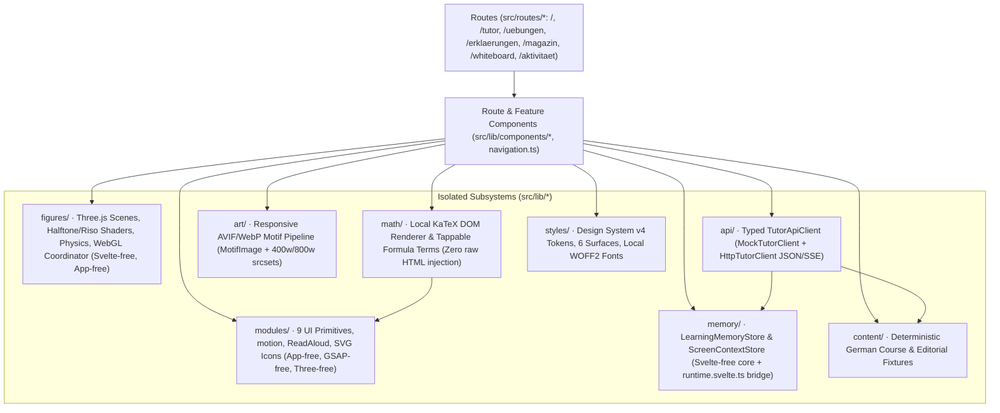

# Architecture & Module Boundaries (`ai-tutor-app`)

`ai-tutor-app` is a statically pre-renderable SvelteKit 5 (`@sveltejs/adapter-static`) application organized around strict, mechanically enforced subsystem boundaries. Architectural rules are verified on every check run via `npm run check:modules` (`scripts/check-modules.mjs`), `npm run check:glyphs` (`scripts/check-glyphs.mjs`), and Node unit tests (`src/**/*.test.ts`).

---

## 1. Layered Dependency Graph

---

## 2. Enforced Subsystem Rules

### 2.1 `src/lib/modules/` — App-Free Design System Primitives

`scripts/check-modules.mjs` parses TypeScript modules, Svelte `<script>` / `<script module>` blocks, template import expressions, and CSS `@import` statements using the Svelte 5 and TypeScript AST compilers.

- **Forbidden imports:** `$app`, `$lib/api`, `$lib/content`, `gsap`, `three`.
- **Required public exports (`src/lib/modules/index.ts`):**
  - **9 UI Primitives:** `SurfaceShell`, `InteractionStage`, `Raster`, `Fader`, `AxisPad`, `Readout`, `FigurePlate`, `Fold`, `BoardCanvas`
  - **2 Services:** `motion` (`core/motion.ts`), `ReadAloud`
  - **1 Sign System:** `Icon`, `ICONS` (`core/icons.ts` — custom 24×24 grid, 1.5 px stroke SVG icons; zero icon fonts or external icon packages)
- **Standalone spring physics (`core/motion.ts`):** Implements `requestAnimationFrame` spring integration without GSAP inside primitives, exposing three deterministic presets (`DESIGN.md` §4.3):
  - `snap` (stiffness `520`, damping `46`, critically damped, ~250 ms, zero overshoot)
  - `carry` (stiffness `260`, damping `24`, preserves release velocity, `≤ 4%` single overshoot)
  - `tick` (stepped readout updates at `12 fps`, zero CSS value transitions)
- **GSAP isolation:** `gsap` is permitted only outside `modules/` (specifically for home-screen `TileGrid` stack choreography).

### 2.2 `src/lib/figures/` — Svelte-Free 3D & Simulation Engine

All 3D rendering, shader pipelines, camera controls, and numerical integrators live in plain TypeScript with zero framework coupling.

- **Forbidden imports (`check-modules.mjs`):** `$app`, `$lib/api`, `$lib/content`, `svelte`.
- **Key modules:**
  - `duck-scene.ts`, `duck-halftone-shader.ts`, `duck-wardrobe.ts`: Loads `static/models/duck_v3.glb` via `GLTFLoader`, welds coincident export normals (`setHullNormals`) for a 3 px screen-space back-face ink outline (`createDuckOutline`), applies flat/halftone ink shading (`createDuckInk`), drives skeletal animation clips + interactive hit zones (`belly`, `head`, `beak`), and toggles 4 wardrobe meshes (`acc_glasses`, `acc_campus_outfit`, `acc_beanie`, `acc_club_mate`).
  - `valley-scene.ts`, `relief-scene.ts`, `riso-shader.ts`: Interactive loss-landscape and attention-weight 3D scenes for `/erklaerungen` and `/uebungen`.
  - `physics.ts`: Fixed-timestep numerical integrator with frame-rate-independent unit tests (`physics.test.ts`), avoiding heavy external WASM physics engines.
  - `fallback-2d.ts`: Supplies deterministic 2D pose and analytical sheet fallbacks for `prefers-reduced-motion: reduce` and headless/non-WebGL environments.

### 2.3 WebGL Slot Coordinator (`src/lib/figures/webgl-coordinator.ts`)

Browsers enforce strict per-tab WebGL context limits, and simultaneous 3D canvases degrade mobile frame pacing. `webglCoordinator` guarantees **at most one live WebGL context** at any instant:

- **Priority hierarchy:** `stage` (rank `3`, e.g., fullscreen `/tutor` duck or active `/erklaerungen` lab) > `tile` (rank `2`) > `companion` (rank `1`, global corner duck).
- **Synchronous revocation:** When a higher-priority requester mounts, `reconcile()` synchronously notifies the previous owner (`notify(false)`) to dispose its `WebGLRenderer` **before** granting `notify(true)` to the incoming scene. Equal-priority requests resolve FIFO.
- **Graceful preemption:** Preempted components (such as the corner companion while a tutorial lab is open) render their lightweight 2D representation until the `stage` slot is released.

### 2.4 `src/lib/memory/` — Svelte-Free Learning Memory & Screen Context

Learner state and contextual awareness are split into a framework-free TypeScript core and a thin Svelte 5 reactive wrapper:

- **Svelte-free core (`types.ts`, `memory-store.ts`, `screen-context.ts`, `snapshot.ts`):**
  - `LearningMemoryStore` persists visits, monotonic active dwell seconds (automatically paused when `document.hidden` is true via `bindVisibility()`), home-tile signals (`keep`, `open`, `dismiss`), inferred topic interests, excluded topics, and user notes/questions under `localStorage` key `tutor.learning-memory.v1`.
  - Uses the Web Locks API (`navigator.locks.request`) when available so concurrent browser tabs serialize storage commits without overwriting each other, falling back cleanly to in-memory storage in private/sandboxed contexts.
  - `ScreenContextStore` holds an immutable snapshot (`structuredClone`) of the currently visible route, section, task, tutorial moment, selected formula term, and `isIndependentProbe` status, clearing stale fields on navigation.
  - Tested directly in Node.js without a browser or Svelte compiler (`memory.test.ts`).
- **Reactive adapter (`runtime.svelte.ts`):** Connects `LearningMemoryStore` and `ScreenContextStore` to Svelte 5 runes for `DuckCompanion.svelte`, `CompanionSheet.svelte`, and `MemoryDrawer.svelte`.

### 2.5 `src/lib/math/` — Local KaTeX Pipeline

Mathematical notation avoids both external CDNs and raw HTML string interpolation:

- **DOM-tree rendering (`katex-render.ts`, `Formula.svelte`):** Calls `katex.render(latex, element, { trust: false, throwOnError: true, maxExpand: 100, maxSize: 10 })` directly on a bound `` after `element.replaceChildren()`, importing local `katex/dist/katex.min.css`.
- **Accessibility & fallback:** Every `FormulaNode` (`editorial-formulas.ts`, `lab-formulas.ts`) carries a mandatory German `spoken` reading exposed via `role="math"` and `aria-label`. If a `katex.ParseError` ever occurs, the visual tree stays empty and the `spoken` text renders visibly inline.
- **Interactive terms (`InteractiveFormula.svelte`, `attention-terms.ts`):** Display formulas can declare tappable pill buttons (`≥ 44×44 px` hit targets, `aria-expanded`, `Escape` key dismissal with focus restoration) that explain individual symbols (e.g., $Q$, $K$, $V$, $\sqrt{d_k}$) and publish the active `FormulaSelection` to `ScreenContextStore` so the corner companion and tutor know which term the learner is inspecting.

### 2.6 `src/lib/art/` & `scripts/optimize-art.mjs` — Unified AVIF/WebP Pipeline

Editorial illustrations follow a single build-time compression contract (`DESIGN.md` §8):

- **Masters (`scripts/art-masters/*.webp`):** 1024 px source illustrations.
- **Deterministic local build (`node scripts/optimize-art.mjs`):** Uses local ImageMagick 7 (`magick` with `libwebp` method 6 and `libheif/aom` speed 4) to emit:
  - `static/art/<id>.webp` (1024 px editorial master)
  - `static/art/tiles/<id>-400.{avif,webp}` and `static/art/tiles/<id>-800.{avif,webp}` (responsive tile variants covering 2× DPR mobile and desktop slots)
- **Quality & grain budgets:** Enforces `≤ 60 KB` per standard tile and `≤ 40 KB` per dark tile (`tutor`, `aktivitaet`, `whiteboard`) while preserving `≥ 90%` high-frequency grain standard deviation relative to downsampled masters.
- **Typed component (`MotifImage.svelte`, `motifs.ts`):** Renders `<picture>` elements with AVIF first, WebP second, explicit `sizes`, focal `object-position`, and curated German `alt` descriptions.

### 2.7 `src/lib/api/` — Dual Mock/HTTP Client & Contract Guards

`src/lib/api/` isolates network and session state behind `TutorApiClient`:

- **Zero-dependency `HttpTutorClient` (`http.ts`):** Implements a streaming UTF-8 fatal `SseParser` (correctly handling split `CRLF`/`CR`/`LF` chunk boundaries), validates every incoming JSON and SSE payload against runtime type guards (`isTurn`, `isMirror`, `isTutorialCheck`, `isExerciseAttempt`, `isProblem`), enforces `session.revision === expectedRevision + 1`, checks media URLs against origin policies (`media.ts`), enforces `isProtectedTutorTurn` client-side, and strips `agentContext` unless `shareWithApi: true`.
- **Stateful `MockTutorClient` (`mock.ts`):** Mirrors concurrency, `requestId` idempotency caching, conflict detection (`409`), whiteboard stroke fingerprinting, graded hint budgets (`HINT_LIMIT = 3`), parallel-example return obligations (`needsReturn`), and `attempts` counting in memory so offline development and automated UI tests exercise the real state transitions.

---

## 3. Design System v4 Mechanical Verification (`src/lib/styles/`)

Design rules in `DESIGN.md` are backed by automated checks rather than manual inspection alone:

1. **Six surfaces, three color layers (`tokens.css`, `tokens-contrast.test.ts`):** Switching `data-surface="paper|white|yellow|orange|crimson|ink"` rebinds ground (`--surface`, `--text`, `--text-muted`, `--hairline`), neutral elevation (`--card`, `--well`), and semantic accents (`--mark`, `--grip`, `--deviation`, `--action`) from a closed 10-color palette. `tokens-contrast.test.ts` parses `tokens.css` and verifies **104 contrast pairs** against WCAG 2.2 AA (`≥ 4.5:1` text, `≥ 3:1` UI boundaries).
2. **Two shapes & one typographic voice (`design-contract.test.ts`):** Scans all `.css` and `.svelte` files to assert that `border-radius` only ever uses square (`0` / `--radius-flat`), pill (`999px` / `--radius-pill`), multi-line option pill (`28px` / `--radius-option`), or circle (`50%`)—rejecting `4–24 px` card radii—and that `--font-code` (`JetBrains Mono`) is restricted exclusively to `[data-code]` selectors while `Archivo` carries the entire UI with `tabular-nums`.
3. **Zero external fonts & zero glyph fallbacks (`fonts.css`, `scripts/check-glyphs.mjs`):** Subsets of `Archivo` and `JetBrains Mono` live locally in `static/fonts/*.woff2`; `check-glyphs.mjs` inspects their binary `cmap` Format 4 and Format 12 subtables directly to prevent silent OS font fallbacks.
